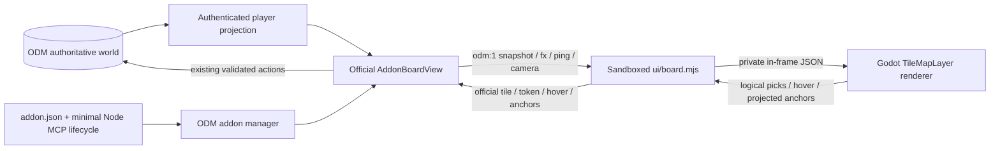

# Isometric Tabletop for Open Dungeon Master

An optional Godot 4 board-view addon. It draws ODM's existing player-safe tactical map with 27 approved pixel-art skins, four-way animated rotation, a true-north arrow, standees, fog and reachable cells. ODM owns authentication, rules, movement, initiative and synchronization. Godot is only the presentation and picking client.

## Install / try locally

Requires ODM's **open addon framework PR #371**, tested at `d2b1f87dd297f55ff7aeea172ac5c873bd653a87`, with the small patches described in [framework-patches.md](docs/framework-patches.md). This is a local preview, not a published release or a direct-core merge.

The package includes its single-threaded Compatibility Web export. **An ODM server needs Node, not Godot, npm install or a separate addon service.** No setup step, downloads, privileges or GPU exclusive lock are requested.

PowerShell, from the framework ODM checkout:

```powershell
$env:ODM_ADDON_DEV_DIRS = 'D:\path\to\isometric-tabletop'
npm run dev -- -H 127.0.0.1 -p 3011
node scripts/check-addon.mjs D:\path\to\isometric-tabletop --run
```

Sign in normally as an administrator, open **Admin > Addons**, enable **Isometric Tabletop**, and use **Settings and checks > Start it and list its tools**. No tools is the expected answer. Open any campaign's tactical board and select **View > Isometric**. **Board** returns immediately to ODM's original renderer. Device options select the starting orientation and name labels. Q/E or the arrow buttons rotate; wheel zooms; middle/right drag pans; 0 fits the board. Select your character using ODM's existing controls; tile and token taps go back to those same host controls.

A runtime-only ZIP can also be installed through the framework. The complete auditable/editable source remains in this project. GitHub/catalog publication is deliberately not configured.

## Build from source

Node >=22.18 and **Godot 4.7.2** with matching official non-threaded Web templates are developer tools. Dependencies are dev-only, locked; the MCP entry has no dependencies.

```powershell
npm ci
npm test
$env:GODOT_BIN = 'C:\path\Godot_v4.7.2-stable_win64_console.exe'
$env:GODOT_WEB_TEMPLATES = 'C:\path\templates'
npm run build:web
npm run test:godot
```

`GODOT_WEB_TEMPLATES` must contain `web_nothreads_debug.zip` and `web_nothreads_release.zip`, extracted from the matching official Godot export templates. Nothing is downloaded or executed during addon installation. `npm run build:assets` deterministically repacks retained sources; `npm run build:ui` rebuilds the original arrow/swish. Neither is needed to use the included approved atlases. Do not regenerate artwork as a build step.

Geometry remains 128x64 logical diamonds, 128x384 packed regions, common contact anchors and guttered nearest-filtered atlases. Stable `ODM-TAG` semantics and door-axis metadata are retained. `config/skins.ts` is the extracted, approved presentation catalogue; `ui/skins.json` is its generated browser data, not a separate hand-maintained binding list. `docs/reference-assets.sha256.json` records source bytes copied from the known-good renderer.

```powershell
npm run package:addon
npm run test:browser -- --url http://127.0.0.1:3011 --world D:\isolated-qa\world.json --credentials D:\isolated-qa\credentials.json
```

For a repeatable synthetic QA world (never a live database):

```powershell
npm run qa:seed -- --odm D:\path\to\framework-odm
# From that ODM checkout:
. .\data\isometric-addon-qa\environment.ps1
npm run dev -- -H 127.0.0.1 -p 3011
```

This creates three ordinary password accounts, one multi-character campaign, and 27 prepared maps. Credentials are in the QA world's ignored `credentials.json`, not this repository. Rerunning preserves the existing world. Reset deliberately by archiving that dedicated QA folder while its server is stopped, then seeding again.

The headed Chrome test uses normal login; credentials and campaign fixtures must belong to a dedicated QA world. It never bypasses authentication. No SwiftShader flags are used. Screenshots and reports go to ignored `artifacts/browser/`. Human visual approval remains separate from browser assertions.

## Architecture



The frame has only `sandbox="allow-scripts"`. It cannot read parent DOM/storage/cookies, receives no credentials, and calls no gameplay API. Static resources use the official public addon UI routes; private world data arrives only in snapshots. Parent-window identity and protocol version are checked. The adapter masks unexplored terrain again and never discovers hidden tokens. Godot picking converts rotated visual coordinates back into unchanged logical ODM coordinates. Authoritative snapshots alone move tokens.

`anchors` are fractions of the iframe, derived from real sprite bounds and the current camera. They update on camera/viewport/token/projection changes, not every idle frame. Names remain upright HTML using the same Cinzel/Geist files as ODM. Skin IDs/material overrides select the unchanged approved catalogue. UI sounds respect optional host-provided global mute/volume; absent preferences mean silence. Host combat FX audio is never duplicated.

## Current limitations

- Baseline export is WebGL 2 / Compatibility, non-threaded. Desktop PR #63 still needs an actual desktop-client test; manifest platform checks are not desktop validation.
- Initial orientation persists through the host's per-device options. Button rotations stay local to the current iframe; API v1 has no addon-to-host option-write message. No private persistence workaround is used.
- Persistent zones, markings, labels and basic aura/FX/ping presentation are supported. Advanced intent/target arrows, live aiming/ruler previews, animated spell effects, backdrop pictures, portrait file replies and detailed light-source glyphs do not yet match the 2D board. Use **Board** for those tools; the campaign state is preserved.
- Godot 4.7.2 logs a caught PWA service-worker warning inside the opaque sandbox even with PWA disabled. No service worker or extra sandbox permission is required; this warning does not prevent rendering.
- A first-use ODM guided tour can intercept View controls until dismissed. The smoke test dismisses the tour through its normal button.
- An intentionally shared generic ladder and some heritage placeholder/shared artwork remain in the approved catalogue; artistic approval does not change their provenance.

## Licensing

Code and the explicitly authorized Zen Garden rotation adaptation: MIT, with existing ODM notices retained. Original isometric artwork and procedural swish: **CC0-1.0**, as authorized by Laurent Sparks, to the extent rights are held; see `godot/assets/LICENSE.md`. No claim of exclusive ownership of generated imagery is made. Godot: MIT plus bundled third-party notices. Unmodified Cinzel/Geist: OFL-1.1, with licence texts in `ui/`. Sources: [Cinzel](https://github.com/google/fonts/blob/main/ofl/cinzel/OFL.txt), [Geist](https://github.com/vercel/geist-font/blob/main/OFL.txt). Build-only Sharp is Apache-2.0; Playwright is Apache-2.0. Third-party material is not relicensed by the artwork dedication.

The current addon catalog requires auditable source and an OSI-approved code licence. This baseline meets that licensing model; proprietary premium services/assets would need a separate distribution decision. No payment, DRM, licensing server or unpublished API is introduced.
