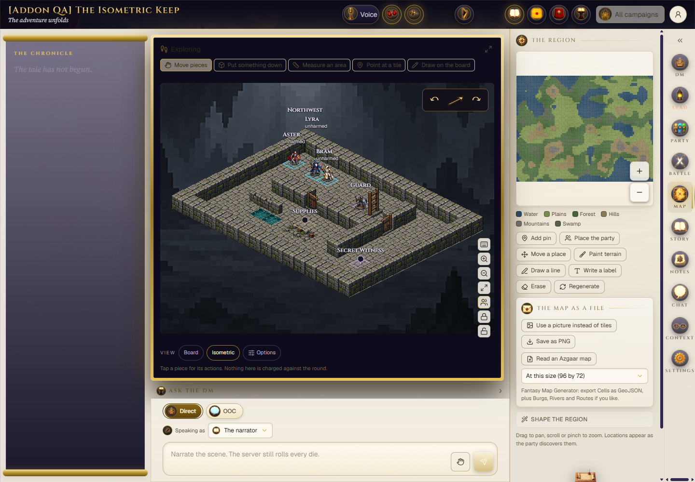
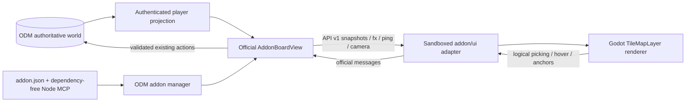

# Isometric Tabletop for Open Dungeon Master

An optional Godot 4 board-view addon: 27 approved pixel-art environments, standees, upright names, player-safe fog, shared markings and animated quarter-turn rotation. **ODM owns authentication, movement, D&D rules, initiative and multiplayer synchronization.** This addon is a presentation and picking client.



[Environments](docs/images/environments.png) · [Four rotations](docs/images/rotation.png) · [Active gameplay](docs/images/gameplay.png)

## Release status

**0.1.0 release candidate — not published.** Tested against official ODM **0.28.0**, upstream `1b4d97d3fe619f3b1024c096337f49cf54d29698`, plus the three small host changes described in [framework-patches.md](docs/framework-patches.md). Unmodified 0.28.0 installs the addon but rejects Godot's resource pack. Do not advertise unmodified-host compatibility before those fixes ship.

The artwork/gameplay baseline has human acceptance approval. Release checks and remaining gates are recorded in [release-readiness.md](docs/release-readiness.md).

## Installation

The public repository and official catalogue submission await owner approval. Once published/audited, use **Admin > Addons** to install the listed addon, or enable file/link installation and select the repository's **`addon/` folder at a pinned commit**. For local review, upload the ZIP produced by `npm run package:addon`.

Enable **Isometric Tabletop**, open an ordinary campaign map, then choose **View > Isometric**. Select **Board** to return to ODM's original view without changing campaign state. No setup step, Godot install, npm install on the server, separate service, runtime download or permission grant is required.

Only `addon/` is installed. Godot/editable artwork, developer tools and tests remain in the same auditable repository outside that folder. See [catalogue submission steps](docs/catalogue-submission.md); no repository URL or catalogue hash has been invented.

## Controls and requirements

- Q/E or arrow buttons rotate; wheel zooms; middle/right drag pans; 0 fits the map.
- ODM controls select the active character and submit authoritative actions. Device options choose starting orientation and name visibility. Button rotations remain local to the iframe.
- Existing global ODM audio mute/volume controls the swish. Reduced motion uses instant turns.
- Verified environment: Windows server, Node supported by ODM, headed Chrome with WebGL 2. The initial manifest declares Windows only. Linux/macOS are structurally portable but not executed here; desktop client and mobile are not verified. No native addon executable is required.

## Known limitations

**Measure on Board.** ODM's temporary ruler/template readout is local host overlay state, not part of API-v1 snapshots. Tile/hover coordinates arrive correctly, but the isometric iframe cannot show that temporary path/area readout. A full measurement bridge is outside this release. Persistent shared lines drawn on Board do arrive as snapshot marks and remain supported.

Advanced aiming/intent arrows, private backdrop/portrait replies and detailed light glyphs also use Board. Basic authorized spell zones, labels, marks, aura/FX feedback are supported; full combat-animation parity is not claimed. Dismiss ODM's first-use guided tour if it intercepts View controls. The shared ladder and approved heritage/shared artwork retain their provenance.

## Troubleshooting

If the view fails, switch to Board, check the host patch level and inspect `index.pck`/`index.wasm` in browser Network. PCK must return 200, not 404; Wasm must use `application/wasm`. Check WebGL 2 support and current Chrome. Do not force SwiftShader or weaken the `allow-scripts` sandbox. A caught Godot PWA service-worker warning is harmless in the opaque frame. No session credentials should ever be supplied to the addon.

Build the ODM distribution in a clean checkout with no QA world under it. Next startup tracing may otherwise include private data. Keep QA data outside the host source tree and audit all production trace files.

## Reproduce the renderer build

Developer tools: Node >=22.18, **Godot 4.7.2** and matching official non-threaded Web templates. Runtime users need none of these extra tools.

```powershell
npm ci
npm test
$env:GODOT_BIN = 'C:\path\Godot_v4.7.2-stable_win64_console.exe'
$env:GODOT_WEB_TEMPLATES = 'C:\path\templates'
npm run build:web
npm run test:godot
npm run release:audit
npm run package:addon
```

Templates contain `web_nothreads_debug.zip` and `web_nothreads_release.zip`. Export writes `addon/ui/`; its source hashes/runtime checksums are tested. Godot can generate different node/resource IDs and pack ordering on a fresh import, so functional rebuilds are verified without claiming byte-for-byte identical packs. `runtime.json.version` is checksum schema version 1; the addon release version is 0.1.0. Do not rebuild approved art for routine packaging. `build:assets` is the optional deterministic source packer, `build:ui` rebuilds the original arrow/swish. No artwork generation runs during install/export.

Geometry stays 128x64 logical diamonds, 128x384 packed regions, common anchors and guttered nearest-filtered atlases. `config/skins.ts` generates `addon/ui/skins.json`; stable material IDs, ODM-TAG and door-axis metadata are unchanged.

## Developer QA

```powershell
npm run qa:seed -- --odm D:\path\to\odm --data-dir D:\isolated-qa --port 3014
# Dot-source the generated environment.ps1, then start ODM normally.
# For real package installation set ODM_ADDON_DEV_DIRS to an empty string.
node D:\path\to\odm\scripts\check-addon.mjs .\addon --run
npm run test:browser -- --url http://127.0.0.1:3014 --world D:\isolated-qa\world.json --credentials D:\isolated-qa\credentials.json
```

The provisioner creates ordinary hashed-password accounts in a synthetic world and preserves them on rerun. Never point it at a personal world. Credentials, worlds, logs and runtime screenshots stay ignored. `test:gameplay` and `test:install` use the same explicit QA arguments. No authentication bypass or SwiftShader flags are used. Human artwork approval remains separate from screenshot assertions.

## Architecture



Opaque `sandbox="allow-scripts"`; no parent DOM/storage/cookies, gameplay HTTP calls or hidden-map fetch. Snapshots alone place tokens. Anchors derive from projected sprite bounds and update only when geometry changes. Names use ODM's unmodified Cinzel/Geist fonts. Host FX audio is not duplicated.

## Licensing and contributing

Code and owner-authorized Zen Garden adaptation: MIT, existing ODM notices retained. Original art/audio: CC0-1.0 to the extent rights are held, with no claim of exclusive generated-image copyright. Godot notices and OFL fonts are retained. See [THIRD_PARTY.md](THIRD_PARTY.md), [artwork records](godot/assets/LICENSE.md), [CHANGELOG](CHANGELOG.md) and [CONTRIBUTING](CONTRIBUTING.md).

No telemetry, payment system, DRM or external account service. Catalogue publication requires auditable source and its normal review; commercial extensions are outside this baseline.

To reproduce the showcase, run `qa:capture-gameplay` with the same explicit QA URL/world/credentials arguments, then `qa:showcase` after the browser capture. Full-resolution originals stay in ignored artifacts; four selected real runtime PNGs in docs/images are intentional public documentation.
